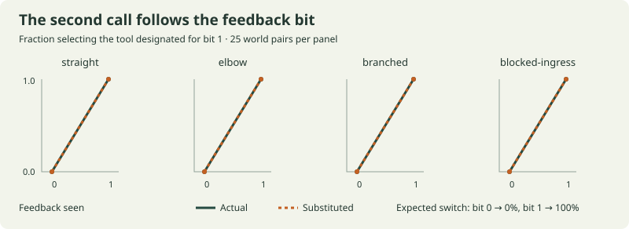

# Paired-world evaluation of frozen Pocket inference

The inference graph and controller from `72f5353` stayed frozen. The exploratory eight-pair batch is separate. The scoring protocol and confirmatory generator were committed at `c10093a` before the 100 confirmatory pairs ran. The graph and controller SHA-256 values are in the outcomes. [Evaluation protocol](PROTOCOL.md) · [Exploratory results](exploratory.json)

## Results

**100 of 100 world pairs made the correct second choice in both actual worlds.** The pair-level Wilson 95% interval is **96.3% to 100%**. This describes the generated mixture of four fixed layout families under the independent-pair approximation. It does not account for family-level dependence or establish transfer to other world rules, prompts, or training seeds.

| Layout family | Actual, both correct | Actual and substituted, all four correct |
| --- | ---: | ---: |
| Straight | 25/25 | 25/25 |
| Elbow approach | 25/25 | 25/25 |
| Branched approach | 25/25 | 25/25 |
| Blocked ingress | 25/25 | 25/25 |

In 75 pairs the target lights exactly at the requested tick in one world and one tick later in its partner. In 25 blocked-ingress pairs it arrives two ticks later in the slower partner. Each pair differs by one hidden source bit or wall bit. Horizons span five to eight ticks. The order of the two named follow-up tools also varies, so a fixed literal tool name cannot solve the balanced pairs. The supplemental 57-pair probe keeps the world fixed and changes the horizon across its arrival boundary. All 57 switch correctly. [Fixed-world timing control](horizon-control.json)

The crossed comparison scores against the bit the controller received. That bit is intentionally counterfactual in the substituted runs. The actual comparison scores against the world. The deterministic policy that evaluates the declared bit-to-tool mapping gives the same intended decisions. No model is asked to invent its own simulation objective.



## Controls and first failure

| Condition | Assigned | End-to-end condition passed | Completed with an answer |
| --- | ---: | ---: | ---: |
| Actual forecast | 200 | 200 | 200 |
| Substituted feedback | 200 | 200 | 200 |
| Irrelevant wall edit | 200 | 200 | 200 |
| Controlled “kindly” wording | 200 | 200 | 200 |
| Precomputed result | 200 | 200 | 200 |
| Tool disabled | 200 | 200 expected stops | 0 |
| Checkpoint absent | 200 | 200 expected stops | 0 |
| Checkpoint too short | 200 | 200 expected stops | 0 |
| Free paraphrase | 200 | 0 | 0 |

All 100 pairs retain their intended decisions after the irrelevant edit, the controlled wording change, and the precomputed reply. Disabled versus enabled task completion differs in all 100 paired units, even though stopping is the correct failure behavior for every disabled run.

The first and only observed failure stage in this study was input admission. All 200 freely phrased tasks contain tokens outside the frozen whitespace vocabulary and fail at event zero. These are assigned failures. The study does not measure the model's downstream reasoning on such wording. Per-stage numerators, denominators, and first wrong events are archived for all runs.

All 1,300 executed forecast calls across confirmatory conditions match the scalar regional frames and the certified full-world cone and target values. This execution check covers the observed calls. The existing synchronous transition and halo invariant supply the exactness argument separately. Corridor checks use the known straight gate-to-target segment.

## Reproduce and inspect

From `visuaml-client/voxel-replay` with the research environment:

```sh
export PYTHONPATH=.:../backend
python tools/evaluate_world_inference_pairs.py
python tools/report_world_inference_pairs.py
npm run dev -- --port 4182
```

Open `/pocket-world-statistics.html` for the family plot and the three downloadable cases. The page labels model decisions as recorded. Its reconstruction button independently regenerates the scalar target trajectory. The original two-scene mechanism demo remains on its own route. Fork performance and latency measurements stay in their earlier benchmark.

[Raw outcomes](outcomes.json) · [Correct switch](switch.json) · [Irrelevant edit](irrelevant.json) · [Input failure at event zero](failure.json)
